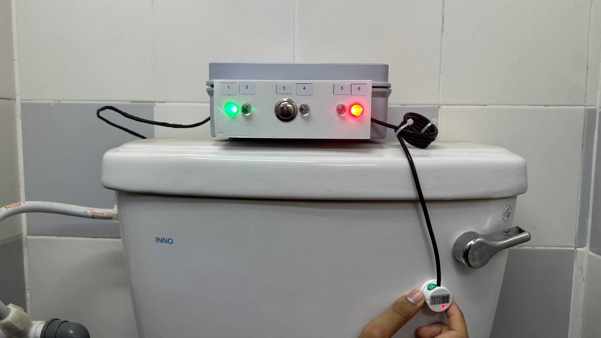
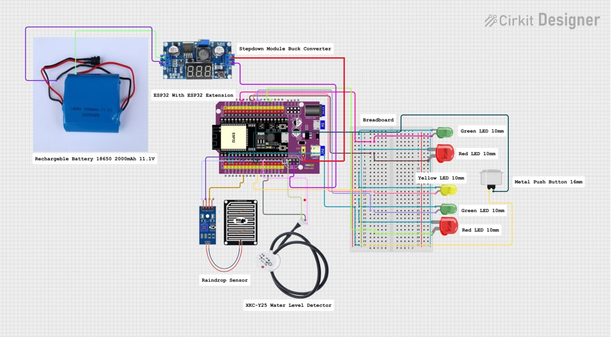

# FlowSense ESP32

Firmware prototype untuk memantau ketersediaan air tandas menggunakan ESP32, Firebase Realtime Database dan Telegram Bot. Versi v4 menggunakan hysteresis untuk mengurangkan perubahan status berulang apabila bacaan sensor berada dekat threshold.

**Oleh Irham Nursyafizan bin Ramli** · [Portfolio](https://bamdev.site)

## Fungsi

- Membaca raindrop sensor secara analog dan sensor air XKC secara digital.
- Menghantar status `available`, `no-water` atau `broken` ke Firebase melalui HTTP PATCH.
- Menghantar notifikasi perubahan sensor dan laporan kerosakan melalui Telegram.
- LED untuk status setempat; butang laporan menggunakan `INPUT_PULLUP`.
- Status kerosakan kekal sehingga `broken_confirmed` ditetapkan kepada `false` oleh admin. Firmware cuba memulihkan status daripada Firebase selepas reboot.

## Perkakasan dan pin

| Komponen | GPIO |
|---|---:|
| Raindrop sensor (analog) | 32 |
| XKC water sensor (digital, active LOW) | 13 |
| Butang laporan (active LOW) | 27 |
| Rain LED hijau / merah | 15 / 4 |
| Water LED hijau / merah | 19 / 17 |
| Alert LED | 16 |

## Setup

1. Pasang Arduino IDE dan sokongan board ESP32.
2. Pasang library **UniversalTelegramBot** dan **ArduinoJson** melalui Library Manager. Sketch menggunakan API `StaticJsonDocument` daripada ArduinoJson 6.
3. Buka `FlowSense_ESP32_v4/FlowSense_ESP32_v4.ino`.
4. Salin `secrets.example.h` kepada `secrets.h` dalam folder sketch. Isi Wi-Fi, Telegram dan Firebase milik sendiri.
5. Semak `TOILET_CODE`, `BLOCK`, `FLOOR_NUM`, `TOILET_NUM` serta pin mengikut pemasangan sebenar.
6. Pilih board dan port ESP32 yang sesuai, compile dan upload. Buka Serial Monitor pada **115200 baud**.

Konfigurasi asal dan token sebenar tidak disertakan. Jangan ubah Firebase rules kepada akses awam untuk memintas pengesahan.

## Aliran data

`Sensors → ESP32 → Firebase /toilets/A1T01 → Dashboard`

Telegram menerima notifikasi secara berasingan daripada ESP32. Dashboard ialah komponen berasingan; kod web dashboard tidak termasuk dalam repo firmware ini.

Raindrop threshold: bacaan **< 2800** bermaksud basah, **> 3200** bermaksud kering, dan julat di antaranya mengekalkan status lama. Threshold perlu dikalibrasi mengikut sensor. Semakan admin dijalankan setiap 5 saat ketika status rosak; kemas kini sensor sekitar setiap saat apabila rangkaian responsif.

## Skop dan batasan

Ini ialah prototype pembelajaran, bukan firmware production. Kod asal menggunakan `client.setInsecure()` untuk sambungan Telegram, panggilan HTTP blocking dan tiada jaminan retry untuk setiap notifikasi. Pemulihan status rosak memerlukan Firebase boleh dicapai semasa boot. `last_update` ialah `millis()` sejak boot, bukan Unix timestamp.

Penyediaan repo ini mengasingkan konfigurasi daripada kod asal; pengujian compile dan hardware belum dijalankan dalam sesi penyediaan. Semak TLS, autentikasi Firebase dan pengendalian kegagalan rangkaian sebelum penggunaan sebenar.
